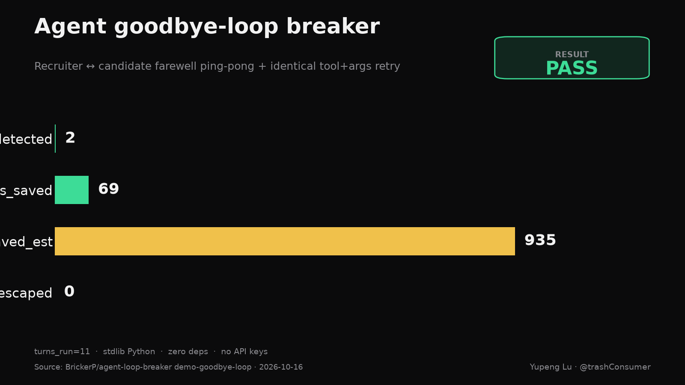

# agent-loop-breaker

[](https://github.com/BrickerP/agent-loop-breaker/actions/workflows/ci.yml)
[](https://www.python.org/downloads/)
[](LICENSE)

**RESULT: PASS — loops_detected=2 · turns_saved=69 · tokens_saved_est=935 · escaped=0**

One command runs two deterministic script agents into a mutual-goodbye dead-loop and an identical tool+args retry, trips a configurable loop breaker mid-run, and writes an append-only event log + HTML report. Stdlib Python. Zero deps. No API keys.



> Built the day an AI recruiter bot and a candidate bot went viral for saying goodbye for ~56 seconds (Graham Dot Zip clip on X) — while Guardian-style write-ups keep reminding teams that agent thrash is a cleanup/rollback cost, not a cute demo. If your agents can spin on farewells or the same tool call forever, you need a breaker before the bill.

## What we use it for

We ran this on **our own simulated interview agents** (no LLM, no network):

| Scenario | Control (breaker OFF) | With breaker | Rule that fired |
|---|---|---|---|
| A · interviewer ↔ candidate goodbye ping-pong | 40 turns | **8 turns** then break | `text_repetition` (FAREWELL ratio ≥ 0.75 over window 6) |
| B · `search_jobs` / `send_email` identical args retry | 40 calls | **3 calls** then break | `tool_args_repeat` (K=3) |

Net vs uncapped control: **turns_saved=69 · tokens_saved_est=935 · escaped=0**.

## Try it (under 2 minutes)

Stdlib Python 3.10+. No install, no API keys, no network.

```bash
git clone https://github.com/BrickerP/agent-loop-breaker.git
cd agent-loop-breaker
PYTHONPATH=src python3 -m agent_loop_breaker demo-goodbye-loop
```

(`demo` is an alias of `demo-goodbye-loop`.)

```
RESULT: PASS
  loops_detected=2  turns_run=11  turns_saved=69  tokens_saved_est=935  escaped=0
  goodbye: control_turns=40  break_turns=8  rule=text_repetition
  tool_retry: control_calls=40  break_calls=3  rule=tool_args_repeat
  event log → docs/demo-events.jsonl
  HTML report → docs/demo-report.html
```

Open `docs/demo-report.html`. Exit code is 0 on PASS and 1 on FAIL, so CI can gate on it.

## Break rules (configurable)

| Rule | Default | Trip when |
|---|---|---|
| `farewell_streak` | 4 | consecutive turns are farewell-like (goodbye/bye/see you/thanks/…) |
| `text_repetition` | window_n=6, threshold=0.75 | dominant normalized fingerprint share ≥ threshold over last N turns |
| `tool_args_repeat` | K=3 | same tool name + args fingerprint consecutive K times |

CLI knobs: `--window-n`, `--repetition-threshold`, `--farewell-streak`, `--tool-repeat-k`, `--max-turns`.

## Event log

Append-only JSONL (`docs/demo-events.jsonl` in the demo): every turn / tool_call / break with seq, agent, scenario, and reason. Suitable as a feed into an audit bus later.

## Tests

```bash
PYTHONPATH=src python3 -m unittest discover -s tests -v
```

## Positioning

AI agent & backend engineer — MCP tools, guardrails, evals, billing, real-time systems.

Hire: https://brickerp.github.io/hire/

## License

MIT · Yupeng Lu
